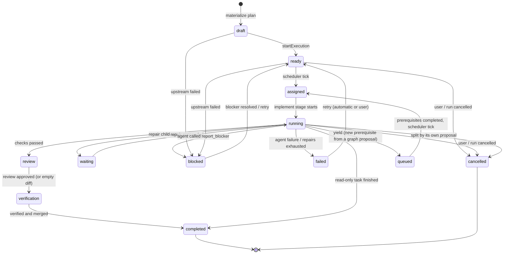
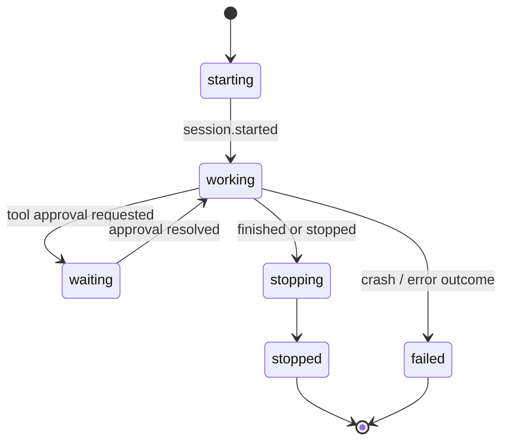
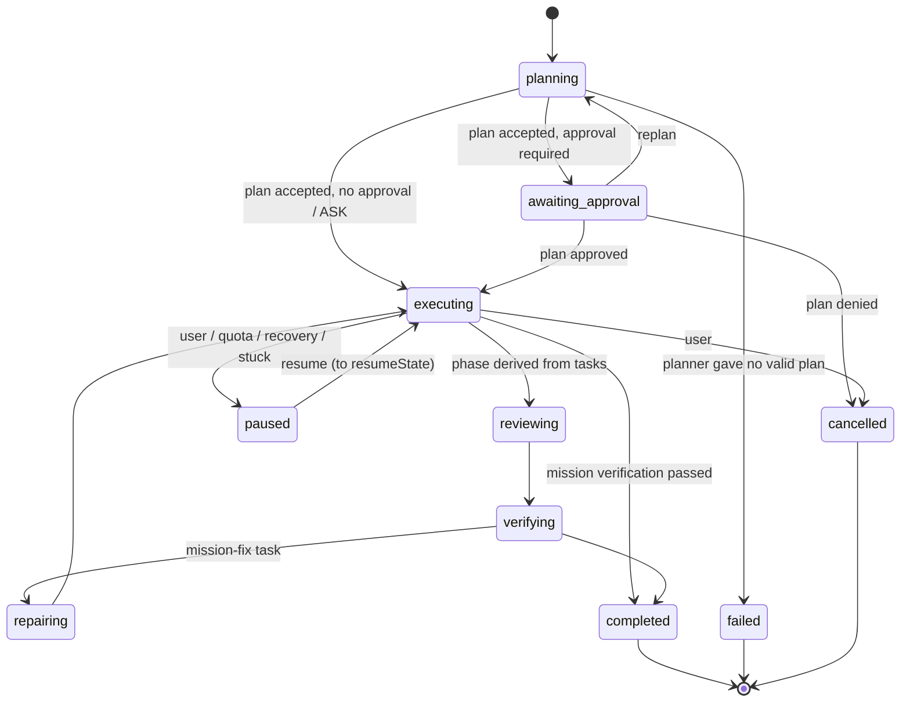

# Task, agent and run lifecycle

Three state machines in `src/main/modules/state/machines.ts` govern persisted state. Every change goes
through `Core.setTaskState` / `Core.setRunState` (or `AgentRunner.setState` for agents), which
call `assertTransition`, write the row and emit the event in one transaction. An illegal transition throws
`NexusError('invalid_transition')`. `tryTaskState` returns null instead of throwing.

## Task state machine

Task states: `draft`, `ready`, `blocked`, `queued`, `assigned`, `running`, `waiting`, `review`,
`verification`, `failed`, `completed`, `cancelled`.

| From | Allowed next states |
|---|---|
| `draft` | ready, blocked, failed, cancelled |
| `ready` | queued, assigned, blocked, failed, cancelled |
| `queued` | assigned, ready, blocked, failed, cancelled |
| `assigned` | running, queued, blocked, failed, cancelled |
| `running` | waiting, review, completed, queued, blocked, failed, cancelled |
| `waiting` | running, review, blocked, failed, cancelled |
| `review` | verification, completed, running, waiting, blocked, failed, cancelled |
| `verification` | completed, running, waiting, blocked, failed, cancelled |
| `blocked` | ready, failed, cancelled |
| `failed` | ready (the only exit; `failed` is retryable, so not final) |
| `completed` | none |
| `cancelled` | none |

`isFinalState('task', s)` is true for `completed` and `cancelled`. `TERMINAL_TASK_STATES` also includes
`failed`, which is what scheduling and "run finished" checks use.

What the orchestrator actually does with them:

In v0.1 `queued` was never entered by the orchestrator. In v0.2 it is the yield state (next section); the scheduler
treats `ready` and `queued` tasks alike.
`review` and `verification` can also fall back to `running` or `waiting` in the table, and the pipeline
uses `waiting` when a repair is started from those stages.

## Yield path and cancellation by a graph proposal (v0.2)

**Yield (`running -> queued`).** When an applied graph proposal gives the proposer's own running task a prerequisite
that has not completed (`ADD_TASK` with `blocksProposer`, or `ADD_DEPENDENCY` on itself), the proposal writes a yield
marker (`graph-yield:<taskId>` in the settings table) and the agent is told to finish its turn. When the turn ends the
pipeline (`yieldIfWaiting`) commits leftovers in the worktree, clears the lease and moves the task to `queued` with a
reason such as `yielded: waiting for <keys> (graph change); resumes once it is merged`. It does not consume an attempt and
does not go through checks, review, verification or merge. The scheduler starts it (`queued -> assigned`) once every
dependency is `completed`. The new implement stage sees the marker, merges the integration branch into the task's worktree,
and runs a fresh session with the prerequisites' result summaries (a "Resuming after a prerequisite" block, recorded in the
context pack); the attempt number stays the same and the marker is cleared. The yield can also be applied while the task is
`assigned` or `waiting`, and after restart or pause `restartOrphans` queues an `assigned` or `running` task that has unmet
prerequisites instead of relaunching it. A marker whose prerequisite already completed still sends the task through the same
resume path.

**Cancelled by split (`... -> cancelled`).** `SPLIT_TASK` creates the subtasks, rewires the original's dependants to depend on
every subtask, and cancels the original (reason `graph proposal by <label>`), together with its repair children. If the split task
is the proposer's own, its agent is not stopped from outside: it is told that the task was replaced and ends its turn, and
the pipeline sees `cancelled` after the implement stage and returns without checks or merge. For any other cancelled
task (split, `CANCEL_TASK` or `REPLAN`) the pipeline working on it is stopped. A cancelled task never satisfies a
dependency, which is why open dependants must be rewired or cancelled in the same proposal.

## Pipeline stages

`TaskPipeline.execute(runId, taskId, startStage, control)` drives one task. Stage type:
`'implement' | 'checks' | 'review' | 'verification'` (plus `'repair'` and `'merge'` reported through
`setStage` for run-phase derivation). The task state is the durable stage marker.

| Stage | Task state | What runs | Persisted |
|---|---|---|---|
| implement | `running` | One agent (role from the plan; worker or debugger writes, others read). Attempt counter incremented unless a session is resumed; lease set. | `agents`, `agent_sessions`, `agent_output`, `tool_events`, `usage_snapshots`; `tasks.resultSummary`; `artifacts` (kind `report`) for non-implementing purposes |
| checks | `running` | `commitLeftovers` commits anything the agent left uncommitted so the reviewed diff equals what is merged; then the project's check commands in the worktree in the order typecheck, lint, build, test, each with a timeout (`checkTimeoutMinutes`, default 15) and 48 KiB of output. | `verification_results` (kind `checks`, no agent, `commands`, `failures`) |
| review | `review` | Skipped if the diff against the merge base is empty. Otherwise a read-only `reviewer` (or `security_reviewer` when the task's risk is `high`) gets requirements, criteria, diff and check output, never the implementer's reasoning. Any `critical` or `high` finding means `changes_requested`. In a dual review (run `reviewMode` `dual`, or `auto` with a high-risk task) two reviewers run concurrently, findings are deduplicated and an arbiter decides which count (see ORCHESTRATION.md). | `reviews` (verdict, summary, findings), `review.*` events, `review_finding` messages to the task |
| verification | `verification` | A read-only `verifier` (which also receives the task's orchestration evidence) judges each acceptance criterion with evidence. It has final authority: one failed criterion or reported failure fails the stage. | `verification_results` (kind `verifier`, criteria, failures); `acceptance_criteria` rows updated to `passed` or `failed` with evidence |
| merge | `verification` | `git merge --no-ff` of the task branch into the integration worktree, under a per-run lock. | `worktrees.state = merged`, `git.merged` or `git.conflict` event |
| complete | `completed` | `task.completed`; verifier-approved memory is promoted when auto-approve is on; the worktree is removed only if `git.removeWorktreesOnSuccess` is set. | |

The loop: `implement -> checks -> review -> verification -> merge`. A failed checks, review or
verification stage, or a merge conflict, goes to `repair` (child debugger task) and then back to `checks`.
The repair bound and escalation are in ORCHESTRATION.md. Review and verification agents that cannot return
valid structured output after two tries raise a pipeline error that fails the task (retryable by hand).

Non-writing tasks skip everything after implement. A task with a `blocker` from the agent becomes
`blocked` instead.

## Agent state machine

Agent states: `idle`, `starting`, `working`, `waiting`, `blocked`, `stopping`, `stopped`, `failed`.

| From | Allowed next states |
|---|---|
| `idle` | starting, stopped, failed |
| `starting` | working, stopping, failed |
| `working` | waiting, blocked, stopping, failed |
| `waiting` | working, blocked, stopping, failed |
| `blocked` | working, waiting, stopping, failed |
| `stopping` | stopped, failed |
| `stopped` | failed |
| `failed` | none |

`AgentRunner` inserts an agent as `starting`, moves it to `working` on `session.started`, toggles
`waiting` and `working` around tool approvals, and finishes it as `stopping` then `stopped`, or `failed`
(outcome other than success or stopped). `idle` and `blocked` are in the table but not entered by the runner.
Each agent row stores role, purpose, label, model reported by the SDK, activity, metrics and error. An
agent is one unit of work and can span several SDK sessions (resume, rotation); each is an
`agent_sessions` row with state `active`, `ended`, `rotated` or `failed`.

## Run state machine

Run states: `planning`, `awaiting_approval`, `executing`, `testing`, `reviewing`, `verifying`,
`repairing`, `paused`, `failed`, `completed`, `cancelled`. The five active phases are `executing`,
`testing`, `reviewing`, `verifying`, `repairing`.

| From | Allowed next states |
|---|---|
| `planning` | awaiting_approval, executing, paused, failed, cancelled |
| `awaiting_approval` | executing, planning, paused, failed, cancelled |
| `executing` | testing, reviewing, verifying, repairing, completed, paused, failed, cancelled |
| `testing` | executing, reviewing, verifying, repairing, paused, failed, cancelled |
| `reviewing` | executing, testing, verifying, repairing, paused, failed, cancelled |
| `verifying` | executing, testing, reviewing, repairing, completed, paused, failed, cancelled |
| `repairing` | executing, testing, reviewing, verifying, paused, failed, cancelled |
| `paused` | planning, awaiting_approval, the five active phases, failed, cancelled |
| `failed`, `completed`, `cancelled` | none |

`completed` is reachable only from `executing` or `verifying`. A paused run records `resumeState` and
`pauseReason` (`user`, `quota` or `recovery`); `resumeTarget(run)` returns the one legal state to resume
into and throws if the run is not paused or has no valid `resumeState`. `canPauseRun(state)` is true for
every state that can move to `paused`.

## Persisted records

The v0.1 tables are created by `src/main/modules/persistence/migrations/001-initial.ts` and the v0.2 tables by `002-v0-2.ts` (additive: nothing in 001 is altered); the schema is
versioned in `schema_migrations`, migrations are append-only, and a database from a newer app version is
refused.

| Table | Contents |
|---|---|
| `projects` | Root path, profile (JSON), `respectProjectClaudeConfig` |
| `runs` | Mode, preset, state, resume state and pause reason, prompt, plan (JSON), base branch and commit, integration branch, `RunConfig` snapshot, error, timestamps |
| `tasks`, `task_dependencies` | Key, role, kind, state, priority, attempt, repair cycles, parent task, tier override, branch, worktree, lease, result summary, structured error |
| `agents`, `agent_sessions` | One agent per unit of work; SDK session ids, end reasons, handoffs |
| `agent_output` | Visible transcript items with a gapless per-agent sequence; no hidden reasoning |
| `tool_events` | Every tool call with input, status (`started`, `completed`, `failed`, `denied`), output preview |
| `run_events` | The durable event log with a global sequence number |
| `agent_messages`, `message_recipients` | Inter-agent and user messages and their delivery |
| `worktrees` | Path, branch, base commit, state (`active`, `merged`, `removed`, `orphaned`) |
| `reviews`, `verification_results`, `acceptance_criteria`, `decisions` | Gate outputs and recorded decisions |
| `memory`, `memory_fts` | Memory entries (status `proposed`, `approved`, `rejected`) and the FTS5 index |
| `approval_requests` | Kind (`plan`, `tool`, `task`, `graph`; `git` and `merge` are defined but unused), action, exact command, risk, status |
| `artifacts` | Task reports (`report`), worktree install logs (`setup-log`) and arbiter decisions (`arbitration`, v0.2) |
| `usage_snapshots` | Per agent token and cost figures as reported by the SDK |
| `settings` | Key-value settings, validated and deep-merged over defaults on read; also small run state keys (`run-active:<runId>`, `usage-cumulative:<sdkSessionId>`, v0.2 `graph-yield:<taskId>`, `graph-approval:<approvalId>`) |
| `graph_revisions`, `graph_proposals` | v0.2: full graph snapshots per version; every proposal with its status, validation errors or denial, and revision link |
| `planning_candidates`, `planning_critiques` | v0.2: consensus planning candidates (plan, validity, errors, duration, model, cost) and critic output |
| `routing_decisions` | v0.2: one per agent: requested and resolved policy, tier, model, reasons |
| `task_outcomes` | v0.2: one row per measured task (unique on task id) |
| `repository_facts`, `repository_facts_fts` | v0.2: facts with source, confidence, files, fingerprint and stale flag, plus an FTS5 mirror |
| `context_packs`, `context_pack_entries` | v0.2: what each agent was given, with the reason for each included and excluded source |

The database is opened in WAL mode with foreign keys on. The event bus persists an event before notifying
subscribers and holds notifications until the surrounding transaction commits, so the UI never sees an
event that does not exist in the database.
